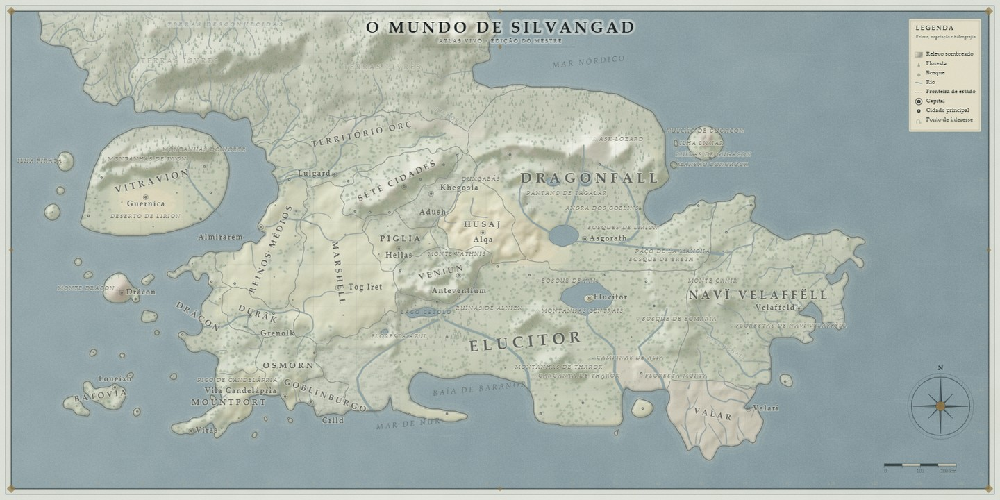
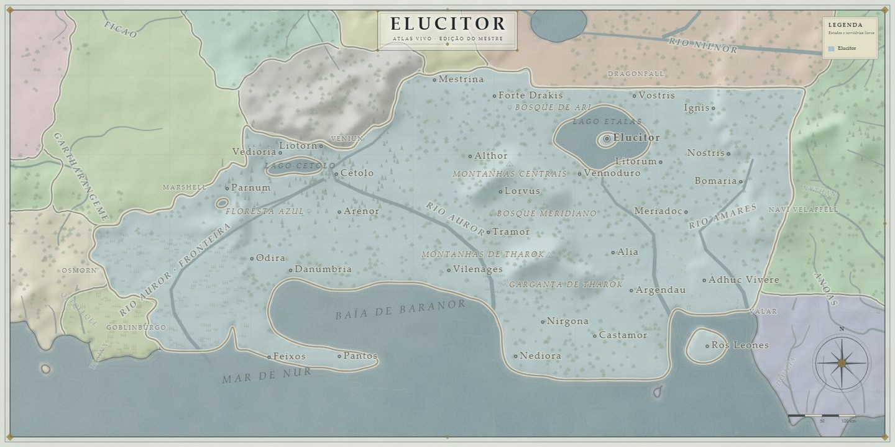

# Silvengard · Atlas vivo

Este é o programa do Atlas. Para usar, **dê dois cliques em `Silvengard-Atlas.exe`**.

---

## Abrir, reiniciar e encerrar

| O que você quer | O que fazer |
| --- | --- |
| Abrir o Atlas | Dois cliques em `Silvengard-Atlas.exe`. O navegador abre no endereço certo sozinho. |
| Abrir de novo (já estava aberto) | Clique no ícone da bandeja (perto do relógio) ou rode o `.exe` outra vez: ele só reabre o navegador. |
| Encerrar a sessão | Botão direito no ícone da bandeja → **Sair (encerra o servidor)**. |
| Fechar só o servidor | Botão direito no ícone → **Parar servidor**. O ícone continua ali para você iniciar de novo. |
| Reiniciar (depois de mexer em arquivos) | Botão direito no ícone → **Reiniciar servidor**. |

O servidor **não fica perdido** em segundo plano: se o `.exe` for fechado de qualquer jeito
(inclusive pelo Gerenciador de Tarefas), o servidor do Atlas é encerrado junto.

Atalhos de linha de comando, se precisar:

```
Silvengard-Atlas.exe                abre o Atlas (com navegador)
Silvengard-Atlas.exe --start        só liga o servidor, sem abrir navegador
Silvengard-Atlas.exe --stop         encerra o servidor de qualquer sessão anterior
Silvengard-Atlas.exe --status       mostra se o servidor está aberto
Silvengard-Atlas.exe --diagnostico  gera app\logs\diagnostico.txt
```

> O Atlas atende apenas este computador (`127.0.0.1`). Nada sai para a internet.

---

## Ver no local (caminhar, pular e voar)

O botão **👁 Ver no local** (ou a tecla **V**) leva você ao chão de **qualquer ponto de terra
firme** — cidade, vila ou ermo. A cena é reconstruída em escala compacta: a cidade é uma
representação do símbolo do mapa (não um censo), o mar ou o lago mantém o tamanho do corpo
d'água original, as montanhas ficam no horizonte e o porto tem cais e barcos. A história da
cidade é lida antes de montar a cena e aparece em uma frase sob o nome do lugar.

| Tecla | O que faz |
| --- | --- |
| **W A S D** / setas | andar |
| **Shift** | correr (e acelerar o voo) |
| **Espaço** | pular |
| **2× Espaço** ou **F** | liga/desliga o voo |
| **Espaço** / **C** (no voo) | subir / descer |
| **T** | troca manhã, dia, entardecer e noite |
| **Esc** | volta ao mapa |

Clique na tela uma vez para olhar ao redor com o mouse. A visão local não altera os dados do
mapa: sair e voltar não muda nada. O botão **🕊 Voo** na barra de baixo faz o mesmo que o
duplo Espaço. Para abrir direto num lugar, acrescente `?local=18` (id da cidade) ou
`?local=800,500` (coordenadas) ao endereço do Atlas.

---

## Mapa 2D para imprimir





O botão **▦ Mapa 2D**, na barra de cima, abre a janela de cartografia. O mapa que sai dela **não
é uma captura da vista 3D**: o Atlas redesenha a carta do zero a partir dos dados — contornos,
relevo, vegetação, rios, fronteiras, nomes, rosa dos ventos, escala, legenda e moldura.

| Opção | Para quê |
| --- | --- |
| **Modo do mapa** | **Terreno** (padrão: relevo, vegetação, rios e fronteiras, sem pintar os estados), **Político** (estados pintados), **População**, **Cultura**, **Religião**, **Bens produzidos**, **Mercados** e **Províncias** |
| **Tema do papel** | Carta azul (como a referência), Pergaminho, Sépia e Noite |
| **Nomes das cidades** | Só as capitais, capitais e principais (**capitais, portos principais, escolas de magia, fortalezas e cidades anãs, fortes e as 30 mais populosas**), todas, ou nenhum nome. Capitais nunca são omitidas: se faltar espaço, as outras cidades cedem e a capital pode ganhar uma linha-guia |
| **Tom dos nomes** | Suave, escuro (padrão) ou contraste alto — e uma **cor personalizada** para todos os nomes, escolhida no seletor de cor |
| **Recorte do mapa** | Mundo inteiro, um **estado** ou uma **província**. O mapa se enquadra e amplia o recorte, esconde cidades e pontos de interesse dos outros estados (naturais na borda ainda aparecem) e filtra nomes e legenda. O título vira o estado e o subtítulo, a província |
| **Enquadramento** | Ajuste (100%), 106% (padrão), 112%, 125% ou 150%. No recorte, amplia sobre o enquadramento automático |
| **Nomes e elementos do recorte** | Com um recorte ativo: ocultar o nome do estado em foco, nomes dos estados na borda, nomes dos outros estados, cidades e pontos de interesse de fora e nomes das outras províncias — desligados por padrão |
| **Título** | Texto, subtítulo, tamanho (85% a 150%) e moldura opcional em volta do título |
| **Pontos de interesse** | Todos, só naturais (bosques, montanhas, lagos, mares, desertos, pântanos, vulcões) ou nenhum |
| **Relevo** | **Sombreado** (padrão: a luz vem do noroeste e as serras aparecem como sombra, sem triângulos), **Picos desenhados** (o traço antigo) ou Nenhum |
| **Rios e lagos** | **Com margens** (padrão: leito azul, contorno escuro dos lados e brilho no centro), Linha simples ou Sem rios |
| **Camadas** | Vegetação, estradas, **fronteiras dos estados**, nomes dos estados, nomes dos rios e o corte de terras desconhecidas ao norte |
| **Acabamento** | Grade e coordenadas, rosa dos ventos, escala, legenda e a posição da legenda |
| **Tamanho** | 2400 × 1200 (rascunho), 3200 × 1600 (tela e A4), 4800 × 2400 (impressão) ou 6000 × 3000 (pôster) |

O **norte** do mundo termina no limite de cima da carta: não é mar, é o fim do que se sabe. O
desenho esmaece a terra junto à borda e marca **TERRAS DESCONHECIDAS**; a opção *Terras
desconhecidas ao norte* liga e desliga esse tratamento.

O **relevo sombreado** substituiu os triângulos pequenos: a grade de alturas é interpolada em
resolução dupla e iluminada do noroeste, de modo que as serras viram sombra no papel. Quem
preferir o traço antigo ainda pode escolher *Picos desenhados* na opção de relevo.

O **recorte do mapa** centraliza a carta num estado ou numa província. O enquadramento se ajusta
com um pouco de contexto ao redor e o zoom continua disponível; só entram as cidades e os pontos
de interesse daquela área, mas serras, bosques e lagos que atravessam a fronteira continuam
aparecendo. O **título** e o **subtítulo** são preenchidos automaticamente (estado no título,
província no subtítulo). Em **Nomes e elementos do recorte** você pode ocultar o nome do estado em
foco, trazer os nomes dos estados na borda, abrir os nomes dos outros estados, as cidades e os
pontos de interesse de fora e os nomes das outras províncias. A legenda é filtrada, um contorno
dourado marca o recorte e o título pode ganhar tamanho maior e moldura.

A **legenda** fica no canto superior direito, sobre o mar, para não tapar as terras do canto
inferior esquerdo; em *Acabamento* você pode devolvê-la ao canto antigo. As **fronteiras dos
estados** são um traço contínuo de tinta, com um halo claro, e aparecem em qualquer modo — ou
desaparecem se você desmarcar a camada. Em todos os modos elas ondulam de leve, com pequenos
desníveis, em vez de correr em linhas retas; o halo claro separa o traço das cores pintadas. A
**costa** é contínua: cada aresta é ligada pelos vértices que ela compartilha com a célula
vizinha e o traçado é alisado depois, sem os trechos soltos que apareciam antes.

A janela mostra a **prévia** inteira e, embaixo, um **recorte central em 1:1** para conferir os
nomes. **Ver em tamanho real** abre a prévia em 1600 px numa aba nova. **Baixar PNG** gera o
arquivo no tamanho escolhido; os nomes e traços são redesenhados na resolução cheia.

Para abrir a janela já num modo, use `?mapa=politico`, `?mapa=populacao`, `?mapa=goods`,
`?mapa=provinces` etc. no endereço do Atlas.

---

## O que é cada pasta

```
Silvengard-Atlas.exe    ← o único arquivo que você precisa abrir
Iniciar-Atlas.cmd       ← plano B, só se o .exe não abrir
Encerrar-Atlas.cmd      ← plano B para encerrar o que o .cmd iniciou

app/                    ← O PROGRAMA (necessário para rodar). Não precisa mexer.
  dist/                 mapa, telas, módulos e o world.json
  serve.py              servidor local
  historic_archives/    os três documentos de história que alimentam a aba "Histórias"
  runtime/node.exe      Node embutido, usado ao gravar os padrões
  tools/bake-defaults.mjs
  saved-author-defaults.json  padrões já aprovados por você
  logs/                 registros de erro de gravação e do inicializador

dados/                  ← dados de referência e checkpoints das revisões
documentos/             ← catálogo, propostas, revisões e o README técnico completo
desenvolvimento/        ← scripts que reconstroem e verificam o mapa, e os testes
acervo/                 ← TUDO O QUE É HISTÓRICO (não é necessário para rodar)
  backups/              uma cópia completa a cada padrão gravado e a cada revisão
  edicoes/              edições exportadas (silvengard-edicao…, alteracoes-mapa…, provincias…)
  previas/              imagens de prévia de cada revisão (preview…, diagnostico…)
  revisoes/             relatórios e verificações das revisões
  pacotes/              os .zip de versões antigas
  logs/                 registros de execuções antigas de teste
  referencias/          desenhos do autor e capturas de tela
```

Regra simples: **se estiver em `acervo/`, é passado.** Nada em `acervo/` é lido pelo programa.

---

## Onde ficam os backups

Cada vez que você usa **Definir como padrão**, o Atlas cria uma pasta nova em
`acervo/backups/defaults-AAAAMMDD-HHMMSS-…/` com:

- `world.json` — como o mapa estava antes da gravação;
- `saved-author-defaults.json` — o histórico de padrões;
- `edition.json` — exatamente a edição que você mandou salvar.

Para voltar atrás, copie o `world.json` da pasta do backup para `app/dist/world.json`.

---

## Se algo der errado

### O `.exe` não abre nada

1. **Plano B (funciona sempre):** dê dois cliques em `Iniciar-Atlas.cmd`. Ele liga o
   servidor do mesmo jeito e abre o navegador. Para encerrar, use `Encerrar-Atlas.cmd`.
2. **Veja o registro:** `app\logs\atlas-launcher.log` — o `.exe` grava cada passo
   (Python encontrado, porta escolhida, servidor pronto). É o primeiro lugar a olhar.
3. **Windows bloqueando:** esta máquina está com o **Smart App Control** ligado, que
   pode recusar programas sem assinatura digital. Se for esse o caso, o `.exe`
   simplesmente não executa e nenhum log aparece — use o plano B acima, ou desligue em
   *Segurança do Windows → Controle de aplicativo e navegador → Smart App Control*
   (atenção: desligar é definitivo; só volta reinstalando o Windows).
4. **Diagnóstico automático:** abra o Prompt de Comando na pasta do Atlas e rode
   `Silvengard-Atlas.exe --diagnostico`. Ele cria `app\logs\diagnostico.txt` com o
   caminho do Python, a porta, o PID e o estado do servidor.

### Outros problemas

1. Olhe `app/logs/salvamento.log` (erros ao gravar padrões).
2. Olhe `app/logs/atlas-launcher.log` (erros ao iniciar o servidor).
3. Feche o Atlas, abra de novo e recarregue a página com `Ctrl+R`.

**Requisito:** Python 3 instalado no Windows. O `.exe` procura o Python
automaticamente (pasta padrão do instalador ou `PATH`); se não encontrar, avisa com o
link oficial. O Node já vai embutido em `app/runtime` — não é preciso instalar.

Se a porta 8765 estiver ocupada por outro programa, o Atlas abre em 8766 (ou na
próxima livre) e avisa no balão da bandeja. O backup e o salvamento continuam iguais.

---

## Git (versionamento)

Esta pasta é um repositório Git ligado a
`https://github.com/arthur-kt/silvengard-interactive-map`. A branch com a
reorganização é **`fix/organize-repo`** (a `main` continua no estado antigo).

O que **não** entra no Git (de propósito, veja `.gitignore`):

- `acervo/backups/` — 1,4 GB de cópias completas;
- `app/runtime/node.exe` — 89 MB, binário redistribuível;
- `app/logs/` e `acervo/logs/` — registros que mudam a cada execução;
- caches do Python (`__pycache__`).

Publicar (faça no **seu** terminal — aqui não há credenciais do GitHub):

```
git push -u origin fix/organize-repo
```

Trazer para o outro clone (`silvengard-interactive-map`), sem internet:

```
cd "C:\Users\Arthur KT\Documents\RPG\silvengard-interactive-map"
git fetch "C:\Users\Arthur KT\Documents\RPG\silvengard-atlas v2" fix/organize-repo
git checkout fix/organize-repo
git merge --ff-only FETCH_HEAD
```

Criar uma nova alteração:

```
git checkout -b minha-mudanca
git add -A
git commit -m "descreve o que mudou"
git push -u origin minha-mudanca
```

---

## Para quem for mexer no código

Veja `desenvolvimento/LEIA-ME.md` (testes, reconstrução do mapa e scripts históricos).

O documento técnico completo das revisões está em `documentos/README.md`.
