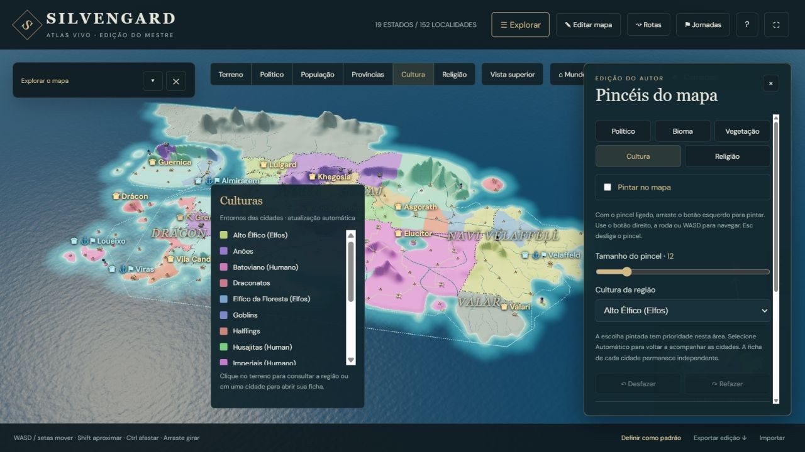
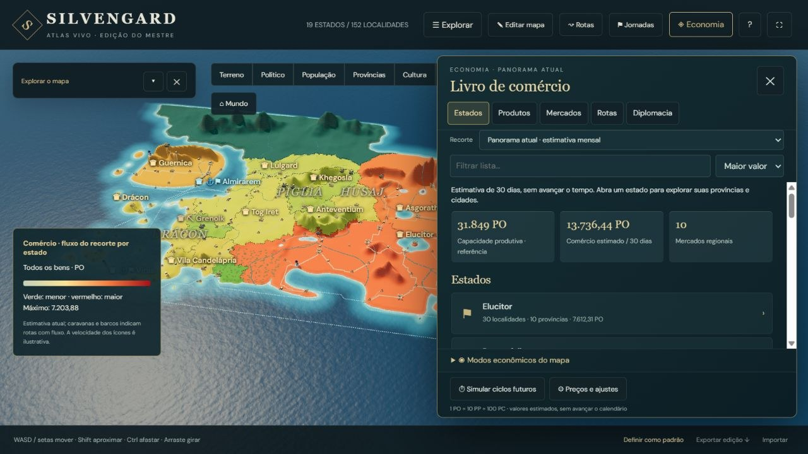
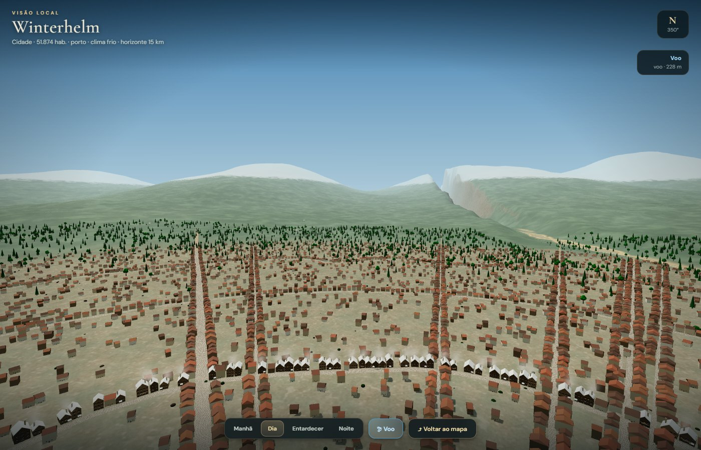
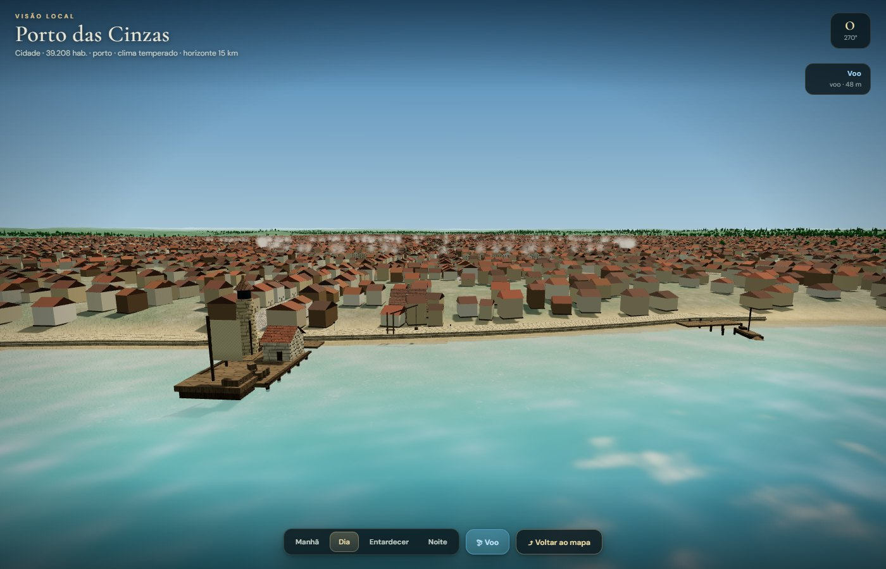
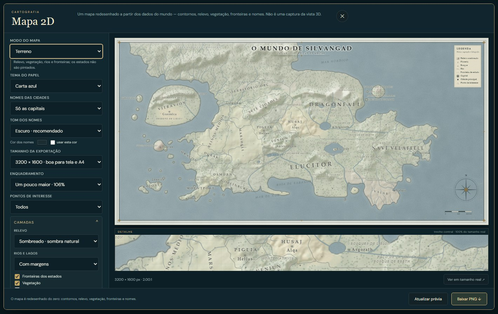
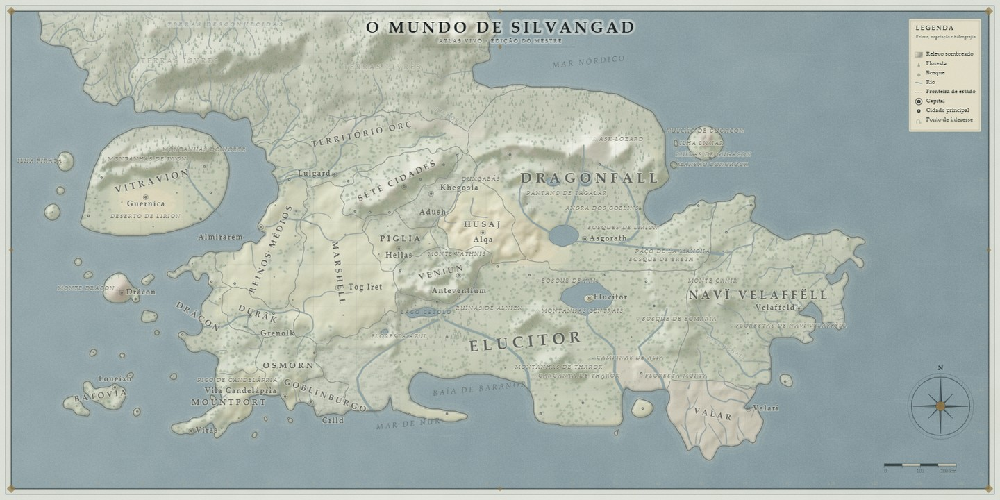

# Silvengard · Atlas vivo

**O mundo de Silvengard num mapa 3D que dá para explorar, editar e simular.**



---

## O que é

Silvengard é um cenário de campanha de RPG. Este repositório é o **Atlas**: um mapa-múndi
tridimensional que roda no navegador, feito para o mestre consultar o mundo, mexer nele e
mostrar à mesa.

O mapa começou como exportação do [Azgaar's Fantasy Map Generator](https://azgaar.github.io/Fantasy-Map-Generator/)
e desde então foi trabalhado à mão: fronteiras, nomes, províncias, cidades, rotas, populações,
economia e história. Hoje é um programa com ferramentas de verdade — pincéis para repintar o
terreno, editor de cidades e de rotas, calculadora de jornadas, leitor das crônicas e um
simulador econômico com dez mercados regionais.

Tudo roda **na sua máquina**. O servidor escuta só em `127.0.0.1`; nada sai para a internet.

## Abrir

1. Dê dois cliques em **`Silvengard-Atlas.exe`**.
2. O navegador abre sozinho em `http://127.0.0.1:8765/`.
3. Para encerrar: botão direito no ícone da bandeja → **Sair**.

O ícone na bandeja também serve para **Parar** e **Reiniciar** o servidor — útil depois de mexer
em arquivos. Se o `.exe` for fechado de qualquer jeito, o servidor morre junto: nada fica perdido
em segundo plano.

| No terminal | O que faz |
| --- | --- |
| `Silvengard-Atlas.exe` | abre o Atlas com navegador |
| `Silvengard-Atlas.exe --start` | só liga o servidor |
| `Silvengard-Atlas.exe --stop` | encerra o servidor de qualquer sessão |
| `Silvengard-Atlas.exe --status` | diz se está aberto |
| `Silvengard-Atlas.exe --diagnostico` | grava `app/logs/diagnostico.txt` |

**Requisitos:** Windows e Python 3 instalado (o `.exe` procura sozinho, inclusive em
`%LOCALAPPDATA%\Programs\Python`). O Node já vem embutido em `app/runtime` — não precisa instalar.
Se a porta 8765 estiver ocupada, o Atlas sobe na próxima livre até 8785 e avisa no balão.

> **Clonou do GitHub?** O `app/runtime/node.exe` fica fora do Git (89 MB). O Atlas abre, navega e
> edita sem ele; só o botão **Definir como padrão** precisa desse binário. Nesse caso, copie o
> `node.exe` de uma instalação que já funciona, ou baixe o Node e coloque em `app/runtime/`.

**Plano B**, se o Windows bloquear o `.exe` (Smart App Control, antivírus): `Iniciar-Atlas.cmd`
liga o servidor do mesmo jeito, e `Encerrar-Atlas.cmd` desliga. O passo a passo completo, com
solução de problemas, está no [LEIA-ME.md](LEIA-ME.md).

## O que dá para fazer

| Ferramenta | O que faz |
| --- | --- |
| **Explorar** | mapa 3D com relevo, vegetação, rios, estradas, rotas marítimas, névoa de Valar, minimapa e busca por cidade ou estado |
| **Camadas** | liga e desliga vegetação, cidades, rios, estradas, fronteiras, pontos de interesse, nomes, barras de população, sombras, água animada — e ajusta o relevo |
| **Mapas temáticos** | político, população, províncias, cultura, religião e economia (mercados, bens produzidos, comércio, quantidade de um bem, preços) |
| **Mapa 2D** | o botão **▦ Mapa 2D** gera uma carta de papel redesenhada a partir dos dados — contornos, relevo sombreado, vegetação, rios com margens, fronteiras de estado, nomes e rosa dos ventos. Tem modos terreno, político, população, cultura, religião, bens produzidos, mercados e províncias; nomes de capitais, principais ou todas as cidades; pontos de interesse (todos ou só naturais); tom e cor personalizada dos nomes; legenda no canto superior direito (ou inferior esquerdo); enquadramento de 100%, 106% ou 112%; quatro temas de papel; e exporta PNG em até 6000 × 3000 |
| **Editar mapa** | pincéis de político, bioma, vegetação, cultura e religião, com desfazer/refazer e tamanho de pincel |
| **Cidades** | ficha completa (população, tipo, fé, língua, perfil social, demografia, brasão), editor e ciclo de vida — criar cidade, conectar à rede, remover com segurança e reparar capitais |
| **Províncias** | 67 províncias com nomes e limites editáveis e prévia no mapa |
| **Rotas e jornadas** | inspetor de rotas com distância e tempo, edição de traçado, e calculadora de viagem por ritmo e velocidade de navio |
| **Histórias** | três documentos longos (história geral, estados e cidades, culturas e instituições) lidos dentro do próprio Atlas, ligados às fichas |
| **Economia** | dez mercados regionais, 85 bens, produção rural e urbana, consumo por classe social, preços locais, fluxos entre mercados, políticas marítimas e ciclos simuláveis |
| **Ver no local** | botão 👁 ou tecla **V**: o Atlas reconstrói o lugar em escala real. A cidade cresce com a população, o mar ou o lago conserva o tamanho do corpo d'água do mapa, as serras ficam no horizonte, as ruas são de pedra e o porto tem cais, trapiches e barcos. **Espaço** pula, **Shift** corre, **2× Espaço** (ou **F**) liga o voo; **T** troca a hora do dia |



A **visão local** não altera nada dos dados: ela lê o mesmo `world.json` e constrói a cena em
código — não há modelos 3D guardados em disco. `local-field.js` traduz o ponto do mapa para a
escala real (1 unidade de cena = 2,2 m; o mapa vale 1.500 m por unidade): a cidade recebe o raio
que a população pede, o mar/lago vem do corpo d'água original, o rio e a serra entram na
proporção certa e o horizonte chega a 15 km. `local-scene.js` desenha o relevo em faixas de
detalhe, a água, as ruas de pedra e a floresta; `town.js` levanta quarteirões, muralhas e porto.
Para abrir direto num lugar, use `?local=18` (id da cidade) ou `?local=800,500` (coordenadas do
mapa) na URL.





## A carta de papel



O botão **▦ Mapa 2D** abre uma janela de cartografia. O mapa não é uma captura da vista 3D: ele é
**redesenhado do zero** a partir do `world.json`, com contornos costeiros traçados a partir das
arestas das células, relevo sombreado e picos desenhados à mão, vegetação por bioma, rios,
fronteiras, nomes, rosa dos ventos, escala, legenda e moldura.

| Opção | O que muda |
| --- | --- |
| **Modo** | terreno (padrão: relevo, vegetação, rios e fronteiras, sem pintar os estados), político, população, cultura, religião, bens produzidos, mercados e províncias |
| **Tema do papel** | carta azul (a referência), pergaminho, sépia e noite |
| **Nomes das cidades** | só capitais; capitais e principais (**capitais, portos principais, escolas de magia, fortalezas e cidades anãs, fortes e as 30 mais populosas**); todas; ou nenhum. Capitais nunca são omitidas: se faltar espaço, as outras cidades cedem e a capital pode ganhar uma linha-guia |
| **Tom dos nomes** | suave, escuro (padrão) ou contraste alto — e uma **cor personalizada** para todos os nomes, escolhida no seletor de cor |
| **Enquadramento** | mundo inteiro (100%), um pouco maior (106%, padrão) ou mais perto (112%) — o mapa cresce ancorado no canto superior esquerdo e corta só o mar das bordas direita e inferior |
| **Pontos de interesse** | todos; só naturais (bosques, montanhas, lagos, mares, desertos, pântanos, vulcões); ou nenhum |
| **Relevo** | **sombreado** (padrão: a luz vem do noroeste e o terreno ganha sombra, sem ícones), **picos desenhados** (o traço antigo, com montanhas pequenas) ou nenhum |
| **Rios e lagos** | **com margens** (padrão: leito azul, contorno escuro dos dois lados e brilho no centro), linha simples ou sem rios |
| **Camadas** | vegetação, estradas, **fronteiras dos estados**, nomes dos estados, nomes dos rios e o corte de terras desconhecidas ao norte |
| **Acabamento** | grade e coordenadas, rosa dos ventos, escala, legenda e a posição da legenda (superior direita ou inferior esquerda) |
| **Tamanho** | 2400 × 1200, 3200 × 1600, 4800 × 2400 ou 6000 × 3000 |

O norte do mundo termina no limite superior da carta: não há mar depois dele, só o que ainda não
foi mapeado, e o desenho esmaece a terra no topo em vez de inventar uma costa. A opção
**Terras desconhecidas ao norte** liga e desliga esse tratamento.

O **relevo sombreado** substitui os antigos triângulos: a grade de alturas é interpolada em
resolução dupla e iluminada do noroeste, de modo que as serras aparecem como sombra no papel.
Quem preferir o traço antigo ainda encontra *Picos desenhados* na opção de relevo.

A **legenda** nasce no canto superior direito, sobre o mar, para não tapar as terras do canto
inferior esquerdo; a opção *Posição da legenda* devolve ao canto antigo quando você quiser. As
**fronteiras dos estados** são um traço contínuo de tinta, com um halo claro para separar os
territórios, e aparecem em qualquer modo (menos quando você as desliga). No mapa físico elas
ondulam um pouco, com pequenos desníveis, para não parecerem réguas; nos mapas pintados seguem
de perto o limite das cores. A **costa** é montada pelos vértices compartilhados das células e
alisada em seguida: o traçado é contínuo, sem as falhas que apareciam quando o mapa ainda era
desenhado pelas arestas das células de borda.

A prévia ocupa a janela e um recorte central em 1:1 permite conferir os nomes. **Baixar PNG**
exporta no tamanho escolhido (o arquivo de 3200 × 1600 sai com cerca de 10 MB; o de 4800 × 2400,
com cerca de 22 MB). Para abrir a janela já num modo, use `?mapa=politico`, `?mapa=populacao`,
`?mapa=goods`, `?mapa=provinces` etc. na URL.

A implementação está em `app/dist/print-map-core.js` (o desenho) e `app/dist/print-map.js`
(a janela e a exportação); o estilo da janela fica em `print-map.css`.



## O mundo em números

| | |
| --- | --- |
| Grade do mapa | 480 × 234 — **112.320 células** de Voronoi |
| Extensão do mapa | 1920 × 937 |
| Estados | **20** entradas (19 com governo + as terras neutras) |
| Cidades e localidades | **152** |
| Províncias | **67** (30 com nome próprio do autor) |
| Pontos de interesse nomeados | **44** |
| Culturas | **23** |
| Religiões | **17** |
| Biomas | **13** |
| Rios | **152** |
| Rotas | **163** (144 terrestres + 19 marítimas) |
| Mercados regionais | **10** |
| Bens econômicos | **85** (83 ativos) |
| Brasões e emblemas | **265** brasões em SVG (de cidades e de estados) e **39** emblemas |
| Histórico de padrões salvos | **18** revisões |

## Como o mapa é feito

```
world.json  →  app/dist/*.js  →  three.js (WebGL)  →  navegador
```

- **Sem build.** O navegador carrega os módulos ES direto de `app/dist/`. Mexeu no arquivo,
  recarregou a página, mudou.
- **`app/dist/world.json`** é o mundo inteiro: células, vértices, estados, cidades, biomas,
  culturas, rios, rotas, pontos de interesse, províncias, economia e histórias.
- **`app/dist/*.js`** desenha o relevo, a água, as árvores e as sombras, e carrega os editores,
  a economia e o leitor de histórias.
- **three.js** está embutido em `app/dist/vendor/` — nada de CDN, funciona sem internet.
- **`app/serve.py`** é o servidor (`http.server` da biblioteca padrão), com duas rotas de API:
  as histórias e a gravação de padrões.
- **`app/runtime/node.exe`** só entra em cena ao usar **Definir como padrão**, para gravar os
  arquivos com backup.

## Estrutura do projeto

```
Silvengard-Atlas.exe     ← o único arquivo que você precisa abrir
Iniciar-Atlas.cmd        ← plano B, se o .exe não abrir
Encerrar-Atlas.cmd       ← plano B para encerrar

app/                     ← O PROGRAMA (não precisa mexer)
  dist/                    mapa, módulos, estilos, world.json, brasões
  serve.py                 servidor local
  historic_archives/       os três documentos de história
  runtime/node.exe         Node embutido, usado ao gravar padrões
  tools/bake-defaults.mjs  gravação dos padrões
  saved-author-defaults.json   histórico de padrões aprovados
  logs/                    registros de erro e do inicializador

dados/                   ← dados de referência e checkpoints das revisões
documentos/              ← catálogo, propostas, revisões, README técnico e imagens
desenvolvimento/         ← scripts de reconstrução, ferramentas, testes e o código do .exe
acervo/                  ← TUDO O QUE É HISTÓRICO (nada aqui é lido pelo programa)
  backups/                 uma cópia completa a cada padrão gravado
  edicoes/                 edições exportadas
  previas/                 imagens de prévia de cada revisão
  revisoes/                relatórios e verificações
  referencias/             desenhos do autor e capturas de tela
```

Regra simples: **se está em `acervo/`, é passado.**

## Salvar e voltar atrás

O botão **Definir como padrão** grava o mundo em `app/dist/world.json` e cria uma pasta nova em
`acervo/backups/defaults-AAAAMMDD-HHMMSS-…/` com o `world.json` de antes, o histórico de padrões
e a edição exata que você mandou salvar.

Para desfazer, copie o `world.json` daquela pasta para `app/dist/world.json` e recarregue com
`Ctrl+R`. Além disso, **Exportar edição** baixa um `.json` e **Importar** devolve — dá para trocar
edições entre sessões.

## Desenvolvimento

```bat
desenvolvimento\rodar-testes.cmd
```

São **37 arquivos de teste** (30 em JavaScript, 7 em Python) cobrindo o mundo canônico, a
economia, as rotas, a população, a edição de cidades e províncias e o leitor de histórias.

| Onde | O que tem |
| --- | --- |
| `desenvolvimento/` | scripts de reconstrução e verificação do mapa |
| `desenvolvimento/ferramentas/` | ferramentas de revisão, uma por etapa da economia e da história |
| `desenvolvimento/testes/` | a suíte; `base.mjs` resolve os caminhos da nova estrutura |
| `desenvolvimento/launcher/` | `Atlas.cs` — o código do `Silvengard-Atlas.exe` (compilado com `csc`) |

Guia de desenvolvimento, com o histórico de cada revisão: [desenvolvimento/LEIA-ME.md](desenvolvimento/LEIA-ME.md).

## Documentação

| Documento | Para quê |
| --- | --- |
| [LEIA-ME.md](LEIA-ME.md) | manual de uso: abrir, encerrar, backups, problemas |
| [documentos/README.md](documentos/README.md) | documento técnico completo, revisão por revisão |
| [documentos/Catalogo-de-Silvengard.md](documentos/Catalogo-de-Silvengard.md) | catálogo do mundo |
| [documentos/Historias-do-Atlas.md](documentos/Historias-do-Atlas.md) | como as crônicas alimentam a aba Histórias |
| [documentos/Silvengard-Economia-e-Mercados.md](documentos/Silvengard-Economia-e-Mercados.md) | a economia por dentro |

## Licença e créditos

Código e dados sob licença **MIT** — veja [LICENSE](LICENSE). © 2026 Arthur Kafrouni Tomazi.

- Mapa-base: [Azgaar's Fantasy Map Generator](https://azgaar.github.io/Fantasy-Map-Generator/)
- Brasões: [Armoria](https://azgaar.github.io/Armoria/), adaptado — veja
  `desenvolvimento/ferramentas/armoria/LICENSE` e `LOCAL-ADAPTATIONS.txt`
- Renderização 3D: [three.js](https://threejs.org/) (MIT), embutido em `app/dist/vendor/`

> Silvengard é um mundo fictício. Nomes, povos, dinastias e a economia inteira saíram de uma
> campanha de mesa — qualquer semelhança com lugares reais é coincidência de mapa.
