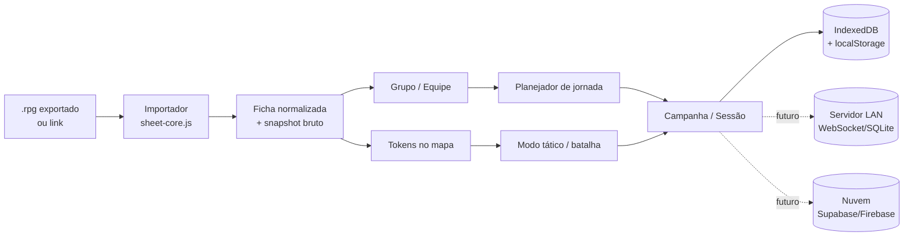

# Fichas do RPG Companion no Atlas de Silvengard

**Análise de viabilidade e proposta de integração**

Data da análise: 11 de novembro de 2026  
Repositório analisado: [`blastervla/rpg-companion-app-systems`](https://github.com/blastervla/rpg-companion-app-systems) (commit `8788e3b`, 15/09/2026)  
Ficha de exemplo: [`leto_al_andalus2026-11-04T00:09:41.743306.rpg`](https://rpg-companion.app/content/BP4A.251205.006/leto_al_andalus2026-11-04T00:09:41.743306.rpg)

> **Nota de implementação (11/11/2026):** a primeira fase foi implementada no Atlas: painel **Fichas** com leitor `.cah`, compêndio 5e de 3.383 recursos e criador provisório com passagem de nível. Veja [Dados-5e.md](Dados-5e.md).

---

## Resumo executivo

**Sim, é possível — mas não do jeito mais direto, e com uma ressalva legal importante.**

1. **O repositório tem, sim, um pacote muito completo de D&D 5e.** Não são só nomes: são **3.383 recursos** do sistema `5e` (1.416 monstros, 538 magias, 734 itens, 194 armas, 148 talentos, 101 raças, 91 antecedentes, 16 classes com **208 subclasses**, 62 armaduras e 11 encontros), mais **366 arquivos de sistema** que definem a ficha, as fórmulas, as views, as mecânicas e o combate. O `5e2024` (2024/5.5e) tem **2.243 recursos** e **369 arquivos de sistema**. São dados suficientes para um compêndio, um construtor de encontros, uma ficha nativa ou validação de ficha.

2. **A ficha usa esses dados de verdade.** O arquivo `systems/5e/system/character_stats.rpgs` define, por exemplo:
   - `speed = race.current_speed + worn_armor_speed_modifier` (então a armadura pesada já entra na velocidade);
   - `armor_class` a partir de armadura equipada, classes e raça;
   - `max_hp`, `proficiency_bonus`, `initiative`, `passive_perception`;
   - e marca com `@party_visible` justamente `name`, `photo`, `current_hp`, `max_hp`, `speed`, `level`, `armor_class`, `passive_perception`, `initiative` e `proficiency_bonus`.
   
   Ou seja: **os campos que o mapa precisa já existem e já são pensados para serem compartilhados com o grupo**.

3. **O link da ficha não entrega o arquivo para o navegador.** Testei o link: ele responde `200` com uma página HTML do próprio site, cujo conteúdo é “To view and interact with this content, please download the RPG Companion app”. O caminho é uma rota do Next.js (`/content/[identifier]/[fileName]`), não um download público. O identificador `BP4A.251205.006` parece ser um build ID do Android (Google Pixel, dezembro/2025), e o nome do arquivo parece ser um snapshot (`nome + timestamp`). **Não confirmei o formato interno do `.rpg`** porque não tenho o arquivo nem o app instalado. Para integrar de forma confiável, precisamos de **um `.rpg` exportado** ou de uma API oficial do app.

4. **O Atlas já tem a metade “mapa” da ideia.** Ele tem grupos, planejador de jornada, rotas, escala de 1,5 km por unidade, histórico, planos, exportação/importação e uma visão local em escala real (1 unidade = 2,2 m). O que falta é a camada de **ficha, token, campanha e multiusuário**. O modelo atual de grupo é só um texto (`players`), não uma lista de fichas.

5. **O caminho recomendado é em fases.** Primeiro:
   - importar um `.rpg` por arquivo (arrastar e soltar);
   - guardar um **snapshot imutável** com hash e data;
   - mostrar uma **ficha resumida** (nome, nível, classe, speed, AC, HP, PP);
   - vincular a ficha a um grupo;
   - usar a **menor velocidade do grupo** no planejador de jornada;
   - colocar um token no mapa.
   
   Depois: campanha, versões/diff, modo tático local, e só então multiusuário. Combate completo e sincronização com a *live session* do RPG Companion são outro produto — e a *live session* é um recurso fechado e pago para hospedar.

6. **Licenciamento é o ponto mais delicado.** O repositório diz **CC BY-NC-SA 4.0** no README e **CC BY-NC 4.0** no `LICENSE.md` (há inconsistência), e o código é MIT. Mas o conteúdo foi importado de livros de D&D (PHB, MM, DMG, XGE, TCE, MOM, FTD, VRGR etc.), não é só SRD. A licença do repositório não pode relicenciar o conteúdo da Wizards of the Coast. Para um app público/comercial, **não bundle** esses dados; use o **SRD 5.1 (CC BY 4.0)** ou dados importados pelo próprio usuário, em um pacote separado do código MIT. Para uso privado de mesa, o risco é menor, mas ainda existe.

**Veredito:** o sonho é realizável, mas a ordem certa é **ficha por arquivo → grupo/jornada → token → campanha → multiusuário/combate**. O link sozinho, hoje, não é uma fonte de dados legível por terceiros; o `.rpg` exportado é.

---

## 1. O que existe no repositório

### 1.1. Estrutura

```
systems/
├── 5e/          D&D 2014
├── 5e2024/      D&D 2024 (5.5e)
├── pf2e/        Pathfinder 2e
└── _stdlib/     macros compartilhadas
```

Cada sistema tem:

```
systems/5e/
├── system/
│   ├── system.rpg.json          metadados, progressão, moedas
│   ├── character_stats.rpgs     stats base/calculados da ficha
│   ├── character_sheet_sections/ 17 seções da ficha
│   ├── combat_system/           iniciativa, XP, dificuldade
│   ├── mechanics/               descanso, condições, nível etc.
│   ├── resources/               definição dos tipos de recurso
│   └── enumerated_types/        listas fechadas (perícias, dano etc.)
└── resource_instances/          os dados: monstros, magias, itens...
```

O clone completo tem **10.330 arquivos / 247,25 MB**. Só o `5e` tem **3.750 arquivos / 82,6 MB**; o `5e2024`, **2.614 arquivos / 60,4 MB**; o `pf2e`, **3.937 arquivos / 104,1 MB**.

### 1.2. O pacote `5e` em números

| Categoria | Recursos | Tamanho aprox. |
|---|---:|---:|
| Monstros | 1.416 | 27,9 MB |
| Itens | 734 | 3,3 MB |
| Magias | 538 | 2,0 MB |
| Armas | 194 | 1,4 MB |
| Talentos | 148 | 1,0 MB |
| Raças | 101 | 2,7 MB |
| Antecedentes | 91 | 1,5 MB |
| Fontes | 72 | 0,01 MB |
| Armaduras | 62 | 0,2 MB |
| Classes | 16 | 12,3 MB |
| Encontros | 11 | 29,6 MB |
| **Total** | **3.383** | **~82,6 MB** (com o sistema) |

As 16 classes incluem as 12 do PHB e também **Artífice** (Eberron), **Blood Hunter** (Critical Role/EGW), **Mystic** (UA) e **Revised Ranger** (UA). São **208 subclasses** embutidas nos arquivos de classe. Só o arquivo do Clérigo tem **2,3 MB**; o do Fighter, **670 KB**.

### 1.3. O pacote `5e2024` em números

| Categoria | Recursos |
|---|---:|
| Itens | 780 |
| Magias | 542 |
| Monstros | 521 |
| Armas | 80 |
| Talentos | 78 |
| Fontes | 72 |
| Armaduras | 61 |
| Espécies | 46 |
| Encontros | 35 |
| Antecedentes | 16 |
| Classes | 12 (48 subclasses) |
| **Total** | **2.243** |

O `5e2024` é o sistema de 2024/5.5e. Para a ficha antiga do Leto, o sistema provável é o **`5e`** (2014), não o `5e2024`.

### 1.4. Os dados são estruturados, não texto solto

Exemplo de uma arma (`weapon_longsword.rpg.json`):

```json
{
  "resource_id": "weapon",
  "stats": {
    "name": { "value": "Longsword" },
    "damage_dice": { "value": [{
      "resource_id": "damage_dice",
      "stats": {
        "dices": { "value": [{
          "resource_id": "dice_roll",
          "stats": {
            "dice_amount": { "value": 1 },
            "dice_type": { "value": "d8" }
          }
        }]},
        "damage_type": { "value": "slashing" }
      }
    }]},
    "is_versatile": { "value": true },
    "versatile_damage_dice": { "value": [/* 1d10 */] }
  }
}
```

Exemplo de magia (`spell_fireball.rpg.json`): nível 3, escola de evocação, `range: "150 feet"`, `8d6` de dano, classes que a aprendem.  
Exemplo de monstro (`monster_goblin_goblin.json`): AC 15, HP `2d6`, speed 30, Stealth +6, ações com ataque e dano.  
Exemplo de classe (`class_fighter_fighter.rpg.json`): proficiências, dado de vida, features e **16 subclasses** com features e efeitos.

Isso é ouro para:
- compêndio e tooltips;
- construtor de encontros;
- validação de ficha;
- fichas nativas;
- importar monstros/NPCs para o mapa.

Mas **não é necessário carregar 82 MB** para o mapa. O mapa precisa de um subconjunto pequeno (nome, retrato, nível, classe, speed, AC, HP, PP). O resto pode ficar para depois, carregado sob demanda.

### 1.5. A ficha usa esses dados

O arquivo `systems/5e/system/character_stats.rpgs` (1.585 linhas) define os stats da ficha. Os trechos mais relevantes:

```rpgs
@party_visible
calc integer speed(name = "Speed") =
  race.current_speed + worn_armor_speed_modifier;

calc integer worn_armor_speed_modifier(name = "Worn armor speed modifier (penalty)") =
  if equipped_armor != null
    then (if strength_score >= equipped_armor.required_strength then 0 else -10)
    else 0;

@party_visible
calc integer armor_class(name = "Armor Class", abbreviation = "AC") =
  max([equipped_armor_ac, classes_ac, race_ac]) + /* escudo */;

@party_visible
calc integer level(name = "Level", abbreviation = "Lvl.") =
  add(map(classes, mapper = ($class) => $class.class_level));

@party_visible
calc integer passive_perception(name = "Passive perception", abbreviation = "PP") =
  10 + perception;

@party_visible
calc integer initiative(name = "Initiative", abbreviation = "Ini.") =
  dexterity_modifier;

@party_visible
calc integer proficiency_bonus(name = "Proficiency Bonus", abbreviation = "PB") =
  1 + divide([level, 4], rounding_method = "up");
```

O `system.rpg.json` do `5e` também declara `"live_session_enabled": true` e `"min_app_version": "1.2.0"`. Ou seja, o sistema já foi desenhado para **sessão ao vivo e visão de grupo**, com `@party_visible` dizendo o que os outros jogadores podem ver.

**Isso é uma excelente notícia para o mapa**: os campos que ele precisa já são exatamente os que o sistema marca como visíveis ao grupo.

---

## 2. O que dá para reutilizar (e para quê)

| Uso | Precisa de quê | Viabilidade |
|---|---|---|
| Compêndio de magias/itens/monstros | Dados completos | Alta, mas licença restritiva |
| Construtor de encontros | Monstros + tabela de XP | Alta; o `combat_system` já tem as tabelas |
| Tooltips de regras | Descrições | Alta, mas texto é o mais protegido |
| Validar ficha importada | Fórmulas + recursos | Média; exige reimplementar um subconjunto |
| Ficha nativa de 5e | Sistema inteiro | Muito alta, mas é outro produto |
| Ficha resumida no mapa | Projeção de ~10 campos | Alta; é o alvo do MVP |
| Tokens/NPCs no mapa | Monstros como recursos | Alta; 1.416 monstros disponíveis |
| Combate completo | Regras, ações, condições, turnos | Baixa/muito alta; não é só dados |

Para o mapa, o alvo realista é a **ficha resumida**. Não vale a pena reimplementar o motor de regras do RPG Companion.

---

## 3. O link da ficha: o que ele é e o que não é

### 3.1. O que o link mostra

```
https://rpg-companion.app/content/BP4A.251205.006/leto_al_andalus2026-11-04T00:09:41.743306.rpg
```

Teste feito em 11/11/2026:

- `HTTP 200`
- `Content-Type: text/html; charset=utf-8`
- `Server: Vercel`
- `X-Matched-Path: /content/[identifier]/[fileName]`
- corpo: página HTML com o logo do RPG Companion e a mensagem **“To view and interact with this content, please download the RPG Companion app”**.

Ou seja: **o navegador não recebe o arquivo**. A rota é uma página de “abra no app”. O app provavelmente resolve o conteúdo pelo backend dele, que não é documentado.

### 3.2. O que dá para inferir

- `BP4A.251205.006` parece ter formato de **build ID do Android** (Google Pixel, atualização de dezembro/2025), não de ID de usuário. Parece ser a versão do app que gerou o link.
- `leto_al_andalus2026-11-04T00:09:41.743306.rpg` parece ser **nome do personagem + timestamp**, ou seja, um **snapshot** gerado no momento do compartilhamento.
- A extensão `.rpg` é usada pelo app para fichas exportadas/compartilhadas; o resto do ecossistema usa `.rpg.json` para recursos e `.rpgs` para o código do sistema. **Não confirmei** se o `.rpg` é JSON puro, JSON comprimido, zip ou um envelope proprietário.
- Não encontrei documentação pública de “importar/exportar ficha” no site de docs; o site cobre criação de sistemas, não a API de personagens.
- As imagens de monstros usam um CloudFront (`dvmqshyfcptwg.cloudfront.net`) que, nos meus testes, respondeu **403** fora do app; não dá para contar com essas URLs no mapa.

### 3.3. O que isso significa para a integração

**O link, sozinho, não é uma fonte de dados legível por um app de terceiros.** Para o mapa importar a ficha, há quatro caminhos:

1. **Exportar o `.rpg` no app** (Share/Export/Salvar em Arquivos) e arrastar o arquivo para o Atlas. É o caminho mais confiável, funciona offline e não depende de API.
2. **Ponte local**: o Atlas sobe uma página de upload na rede local (QR code), o celular envia o `.rpg` para o PC. Útil para mesa presencial; exige modo LAN e token de sessão.
3. **API oficial**: pedir ao desenvolvedor (feedback@blastervla.com) um endpoint de exportação/importação ou uma integração. É o caminho “limpo” para o link funcionar direto.
4. **Não recomendado**: engenharia reversa do backend/do app para descobrir a API privada. Frágil, pode violar os termos de uso e quebra a cada atualização.

**Próximo passo prático:** exporte a ficha do Leto no app e me envie o `.rpg`. Com o arquivo em mãos, eu confirmo o schema, monto o normalizador e digo exatamente quais campos estão disponíveis (inclusive se `speed` e `AC` vêm calculados ou só os stats base).

---

## 4. O Atlas hoje

### 4.1. Arquitetura

- **Sem build**: o navegador carrega os módulos ES direto de `app/dist/`. Mexeu no arquivo, recarregou, mudou.
- **`app/dist/world.json`**: o mundo inteiro (112.320 células de Voronoi, 152 cidades, 163 rotas, 20 estados, 67 províncias, 44 pontos de interesse, 23 culturas, 17 religiões, 85 bens, 10 mercados).
- **`app/dist/*.js`**: three.js, relevo, água, cidades, economia, histórias, jornadas.
- **`app/serve.py`**: `http.server` da biblioteca padrão, escutando **só em `127.0.0.1`**, com duas rotas de API: `/api/history` e `/api/defaults`.
- **Persistência**: `localStorage`, chave `silvengard-atlas-v1` para edições e `silvengard-journeys-v1` para grupos/jornadas. Exportação/importação em JSON.
- **Sem contas, sem banco, sem autenticação, sem multiusuário.**

### 4.2. O planejador de jornada

O modelo atual de grupo (`app/dist/journeys.js`) é:

```js
{
  id, name,
  players,                    // texto livre, não lista de fichas
  location: { xy, label },
  waypoints: [{ xy, label }],
  settings: { pace, mode, hours, scale, terrain, gallop, rest, fresh, load, capacity, shipSpeed },
  history: [{ name, date, points, distance, moving, elapsed, from, to }],
  plans: [{ name, waypoints, settings }]
}
```

O cálculo (`app/dist/travel-core.js`) usa:

```js
export const PACES = {
  fast:   { speed: 6,   label: 'Rápido' },
  normal: { speed: 4.5, label: 'Normal' },
  slow:   { speed: 3,   label: 'Lento' }
};
```

e `simulate()` aplica terreno difícil, marcha forçada, descanso, montaria, galope, navio etc. A escala padrão do mundo é **1 unidade = 1,5 km** (`settings.distanceScale`), e a visão local usa **1 unidade = 2,2 m** (`M_PER_UNIT=2.2`, `WORLD_M_PER_UNIT=1500` em `app/dist/local-field.js`).

**O que já dá para reaproveitar:**
- `point(x, y)` para converter coordenadas do mapa em posição 3D;
- `createJourneys` para o painel, histórico, planos e desenho da rota;
- `simulate` para distância/tempo/descanso;
- `cleanJourneys` para validar o JSON;
- `exportEdition`/`import` para serializar tudo.

**O que falta:**
- fichas de personagem;
- lista de membros no grupo (hoje é texto);
- tokens no mapa;
- campanha/sessão;
- permissões (mestre vs jogador);
- multiusuário.

### 4.3. Escalas: o ponto crucial do “30 pés”

| Escala | 1 unidade | 30 pés | O que faz sentido |
|---|---:|---:|---|
| Mapa-múndi | 1.500 m | **0,0061 unidade** | viagem, rotas, dias |
| Visão local | 2,2 m | **4,16 unidades** | cidades, rua, batalha |
| Grade tática | 5 ft (1,524 m) | **6 quadrados** | combate por turnos |

No mapa-múndi, 30 pés é **sub-pixel**: não faz sentido animar um token andando 30 pés por turno ali. O que faz sentido no mundo é o **ritmo de viagem** (km/h, horas/dia, terreno, descanso). Já na **visão local** (1 unidade = 2,2 m) e numa **grade de batalha** (1 quadrado = 5 ft), 30 pés é uma medida visível e útil.

**Recomendação:** separar dois modos:
- **Modo viagem** (mapa-múndi): velocidade do grupo em km/h, derivada do ritmo do Atlas;
- **Modo tático** (visão local/grade): deslocamento em pés/quadrados, com 30 ft = 6 quadrados, alcances e áreas de efeito.

Isso evita a frustração de tentar usar combate de 30 ft numa escala de 1,5 km por unidade.

---

## 5. Arquitetura proposta

### 5.1. Visão geral



### 5.2. Camadas

1. **Importador (`sheet-core.js`, puro, testável)**
   - recebe `File`/`ArrayBuffer`/JSON;
   - detecta sistema (`5e` vs `5e2024`);
   - desembrulha o envelope `{resource_id, stats: {campo: {value: ...}}}`;
   - projeta os campos que o mapa usa;
   - valida e devolve erros claros.

2. **Registro de fichas (`sheets.js`)**
   - CRUD de fichas;
   - snapshot bruto + projeção;
   - versões;
   - busca por nome/jogador/campanha.

3. **Campanha/Equipe (`campaigns.js`)**
   - campanha: nome, sistema, mestre, roster, sessões;
   - equipe/grupo: membros, ordem de marcha, papéis, localização, rota, planos;
   - permissões: mestre vê tudo; jogador vê o que é `@party_visible`.

4. **Tokens (`tokens.js`)**
   - marcador 3D no mapa (retrato ou inicial);
   - posição no mundo ou na cena local;
   - anel de velocidade/alcance no modo tático;
   - formação/ordem de marcha.

5. **Jornada (`journeys.js` estendido)**
   - `members` em vez de só `players` (mantendo o texto como fallback);
   - velocidade do grupo = menor velocidade dos membros a pé;
   - montaria/veículo sobrescreve;
   - histórico e planos continuam.

6. **Sincronização (futuro)**
   - LAN: servidor Python + WebSocket/SSE + SQLite/JSON;
   - nuvem: Supabase/Firebase/PartyKit + auth + RLS;
   - servidor autoritativo para posições/combate; cliente interpola.

### 5.3. Modelo de dados sugerido

**Ficha:**

```json
{
  "id": "sheet:leto-al-andalus",
  "system": "5e",
  "source": {
    "kind": "file",
    "fileName": "leto_al_andalus2026-11-04T00:09:41.743306.rpg",
    "url": "https://rpg-companion.app/content/...",
    "sha256": "…",
    "importedAt": "2026-11-11T18:00:00Z",
    "appBuild": "BP4A.251205.006"
  },
  "snapshot": { "...": "bytes/JSON original, imutável" },
  "projection": {
    "name": "Leto al Andalus",
    "level": 5,
    "classes": ["Fighter 5"],
    "species": "Human",
    "speedFt": 30,
    "armorClass": 18,
    "maxHp": 44,
    "currentHp": 44,
    "initiative": 2,
    "passivePerception": 13,
    "portrait": null
  },
  "versions": [
    { "sha256": "…", "importedAt": "…", "summary": { "level": 5, "ac": 18, "speedFt": 30 } }
  ]
}
```

**Campanha:**

```json
{
  "id": "campaign:silvengard",
  "name": "Silvengard",
  "system": "5e",
  "dm": "Arthur",
  "roster": ["sheet:leto-al-andalus", "sheet:…"],
  "sessions": [
    { "id": "session:12", "date": "2026-11-15", "title": "A estrada de Winterhelm", "partyId": "party:…" }
  ]
}
```

**Grupo/equipe:**

```json
{
  "id": "party:…",
  "campaignId": "campaign:silvengard",
  "name": "Os Andarilhos",
  "members": [
    { "sheetId": "sheet:leto-al-andalus", "role": "batedor", "marchingOrder": 1 }
  ],
  "location": { "xy": [800, 500], "label": "Estrada de Winterhelm" },
  "settings": { "pace": "normal", "mode": "foot", "hours": 8, "scale": 1.5 },
  "history": [],
  "plans": []
}
```

**Token:**

```json
{
  "sheetId": "sheet:leto-al-andalus",
  "scope": "world",
  "xy": [800, 500],
  "speedFt": 30,
  "marchingOrder": 1,
  "color": "#c9a227"
}
```

### 5.4. Onde guardar

| Dado | Onde | Por quê |
|---|---|---|
| Snapshot bruto `.rpg` | **IndexedDB** (blob) | Pode ser grande; localStorage tem ~5 MB |
| Projeção da ficha | IndexedDB ou localStorage | Pequena, acesso rápido |
| Campanhas/grupos/tokens | localStorage (ou IndexedDB) | Compatível com o modelo atual |
| Histórico de versões | IndexedDB | Vários snapshots |
| Sessão multiusuário | SQLite/JSON no servidor | Fonte da verdade compartilhada |

O export/import atual (`exportEdition`) pode ser estendido para incluir `sheets`, `campaigns`, `tokens` e `sheetVersions`, com validação e limite de tamanho.

---

## 6. Movimento, 30 pés e velocidade do grupo

### 6.1. Conversões básicas

- 1 ft = **0,3048 m**.
- 30 ft = **9,144 m**.
- 30 ft por round (6 s) = **1,524 m/s** = **5,49 km/h** instantâneos.
- No mapa-múndi (1 unidade = 1.500 m): 30 ft = **0,006096 unidade**.
- Na visão local (1 unidade = 2,2 m): 30 ft = **4,156 unidades**.
- Na grade de 5 ft: 30 ft = **6 quadrados**.

### 6.2. Ritmo de viagem

O Atlas usa três ritmos fixos: **3 / 4,5 / 6 km/h**. O D&D 5e usa a tabela de *travel pace* (rápido 4 mph, normal 3 mph, lento 2 mph, assumindo speed 30). Para encaixar a ficha no Atlas, o mais simples é:

| Speed da ficha | Ritmo sugerido no Atlas | Observação |
|---:|---|---|
| 20–25 ft | **Lento (3,0 km/h)** | anão com armadura pesada, criatura lenta |
| 30 ft | **Normal (4,5 km/h)** | padrão |
| 35–40 ft | **Rápido (6,0 km/h)** | bárbaro/monge, botas velozes |

Isso é uma **aproximação de mesa**, não uma regra oficial. O importante é usar o **menor `speed` do grupo** (a não ser que todos tenham montaria/veículo) e deixar o mestre sobrescrever.

**Cuidado importante:** o `speed` da ficha **já inclui** a penalidade de armadura (`worn_armor_speed_modifier`). Não subtraia de novo. Se o Leto usa armadura pesada e tem Força abaixo do requisito, o `speed` dele pode ser 20 ft, não 30 ft. O mapa deve usar o valor calculado, não o valor base da raça.

### 6.3. Exaustão e outras penalidades

- **2014:** exaustão nível 2+ reduz a velocidade pela metade.
- **2024:** cada nível de exaustão reduz 5 ft.
- **Carga variante:** -10/-20 ft.
- **Terreno difícil:** já entra no `simulate` como esforço dobrado.

Se a ficha exportar `exhaustion`/`encumbrance`, o mapa pode aplicar; se não, o mestre ajusta manualmente. Não invente: mostre “speed 30 ft (base) / 20 ft (efetiva)” quando houver penalidade.

### 6.4. Velocidade do grupo

```js
// proposta
const walkers = members.filter(m => m.mode !== 'mount' && m.mode !== 'vehicle');
const groupSpeedFt = Math.min(...walkers.map(m => m.speedFt));
const pace = groupSpeedFt <= 25 ? 'slow' : groupSpeedFt >= 35 ? 'fast' : 'normal';
```

Se todos estiverem montados, use a velocidade da montaria; se houver um veículo, a do veículo; se o grupo se separar, cada subgrupo tem sua velocidade. O `travel-core.js` já tem `mode`, `gallop`, `load`, `capacity`; basta alimentar com a ficha.

### 6.5. Modo tático

Para combate, o ideal é uma **grade de 5 ft** na visão local:
- cada quadrado = 5 ft = 1,524 m = **0,693 unidade de cena** (2,2 m por unidade);
- 30 ft = 6 quadrados = **4,16 unidades**;
- alcance de magia (ex.: fireball 150 ft = 30 quadrados; raio de 20 ft = 4 quadrados);
- movimento por turno, dash, terreno difícil, alcance de arma.

O `street.js`/`local-scene.js` já renderizam a cidade em escala; um overlay de grade e tokens é viável. Mas isso é **fase 3**, não MVP.

---

## 7. Campanha, equipe e combate

### 7.1. Campanha vs equipe

- **Campanha** = o mundo + o roster + as sessões + a linha do tempo. Pode ter várias equipes.
- **Equipe/grupo** = um subconjunto de fichas que viaja junta, com ordem de marcha, localização, rota e planos.
- **Sessão** = um recorte temporal da campanha, com data, título, notas, tokens e, se houver, combate.

O modelo atual de `parties` já é quase uma equipe; falta `campaignId`, `members` e `sessionId` no histórico. A compatibilidade com o formato antigo é fácil: manter `players` como texto e adicionar `members` opcional; `cleanJourneys` aceita os dois.

### 7.2. Permissões e `@party_visible`

O sistema 5e já marca o que é visível ao grupo:

- `name`, `photo`, `current_hp`, `max_hp`, `speed`, `level`, `armor_class`, `passive_perception`, `initiative`, `proficiency_bonus`.

O mapa pode usar exatamente essa lista para a **visão do jogador**. O mestre vê tudo (ficha completa, notas, história). Isso alinha o mapa ao modelo do app e evita inventar regras de privacidade.

### 7.3. Combate: não duplicar o que o app já faz

O RPG Companion já tem:
- iniciativa;
- encontros;
- orçamento de XP e dificuldade;
- condições, HP, descanso, morte;
- *live session* (entrar é grátis; **hospedar exige assinatura Premium DM**).

O Atlas deve fazer o que o app não faz bem: **espaço**. Posições, distâncias, alcances, áreas, linha de visão, formação, viagem. O app continua sendo a **fonte da verdade das regras**.

Se não houver API, a sincronização é manual:
- o mestre importa o snapshot no início da sessão;
- o mapa mostra tokens e distâncias;
- HP/condições são atualizados no app (e, se quiser, o mestre corrige no mapa);
- no fim, o mapa guarda um snapshot da sessão.

Reimplementar combate completo no mapa é possível, mas é **outro produto**: ações, reações, concentração, death saves, legendary actions, lair actions, efeitos, alvos, dados... O repositório tem pedaços disso, mas não é um VTT.

### 7.4. Multiusuário: o que é possível

| Modo | Como | Esforço | Quando |
|---|---|---|---|
| **Tela compartilhada** | Um PC/projetor; todos veem o mesmo mapa | Nenhum | Hoje |
| **LAN** | Servidor no PC do mestre; celulares na mesma Wi-Fi; WebSocket/SSE; token de sessão | Médio | Fase 4 |
| **Nuvem** | Supabase/Firebase/PartyKit; login; RLS; sync offline | Alto | Futuro |
| **Live session do app** | Integração oficial com o backend do RPG Companion | Desconhecido | Só com API/parceria |

A *live session* do app **não tem uma API pública que eu tenha encontrado**: é um recurso do app, com hospedagem paga. Não dá para “entrar” nela a partir do Atlas sem uma integração oficial. Se isso for importante, o caminho é conversar com o desenvolvedor (feedback@blastervla.com) e propor uma parceria/endpoint.

Para LAN, o `serve.py` atual é uma base simples, mas precisa de:
- bind em `0.0.0.0` só com flag `--lan`;
- token de sessão e aprovação do mestre;
- WebSocket ou SSE (o `http.server` puro não faz WebSocket; dá para usar `websockets`/`aiohttp` ou o `node.exe` embutido com `ws`);
- estado compartilhado em SQLite/JSON;
- limite de taxa e validação;
- firewall e aviso de segurança.

---

## 8. Versões, download e histórico

### 8.1. Snapshot imutável

Cada importação cria um **snapshot**:

```json
{
  "sha256": "…",
  "fileName": "leto_al_andalus2026-11-04T00:09:41.743306.rpg",
  "sourceUrl": "https://rpg-companion.app/content/...",
  "importedAt": "2026-11-11T18:00:00Z",
  "system": "5e",
  "appBuild": "BP4A.251205.006",
  "raw": "<bytes>",
  "projection": { "name": "Leto", "level": 5, "speedFt": 30, "ac": 18, "hp": 44 }
}
```

Nunca sobrescrever. Reimportar = **nova versão**. O histórico mostra:
- data;
- nível;
- AC/HP/speed;
- mudanças de equipamento/magias (se o schema permitir diff);
- hash.

### 8.2. Diff

Um diff simples já é útil:
- “subiu para nível 6”;
- “AC 18 → 19”;
- “speed 30 → 20 (armadura nova)”;
- “aprendeu Fireball”;
- “HP máximo 44 → 52”.

Se o `.rpg` for JSON com os recursos aninhados, o diff pode ser estrutural. Se for binário/zip, o diff é por projeção e por hash.

### 8.3. Exportar

- **Original**: baixar o `.rpg` exatamente como importado (prova de origem).
- **Pacote do Atlas**: JSON com fichas, campanhas, grupos, tokens e versões (para backup/troca de máquina).
- **Ficha resumida**: JSON/CSV para o mestre.

O export atual do Atlas já baixa um JSON; basta incluir as novas seções e versionar o formato (`silvengard-atlas-v2`).

### 8.4. Link vs arquivo

| Fonte | O que guardar | Observação |
|---|---|---|
| Arquivo `.rpg` | bytes + hash + nome | Confiável, offline |
| Link | URL + data + build ID | Não é o arquivo; não dá para ler no navegador |
| API oficial (futuro) | JSON + ETag/hash | Só com endpoint documentado |
| Criação manual | campos digitados | Fallback para quem não usa o app |

---

## 9. Licenciamento e riscos

### 9.1. O que o repositório diz

- README: conteúdo **CC BY-NC-SA 4.0**; código **MIT**.
- `LICENSE.md`: conteúdo **CC BY-NC 4.0** (ShareAlike “recomendado”, não obrigatório).
- Há uma **inconsistência** entre os dois. Para usar, vale tratar como **CC BY-NC-SA 4.0** (a mais restritiva, por causa do ShareAlike) e pedir confirmação ao autor.

### 9.2. O problema maior: D&D não é só SRD

O repositório foi alimentado por dados de livros de D&D (o próprio repositório tem uma skill de importação de 5etools). As fontes incluem:

- PHB, MM, DMG (em parte SRD);
- XGE, TCE, MOM, FTD, VRGR, EGW, SCC, BGG, entre outras (majoritariamente **não SRD**).

A licença CC do repositório **não pode relicenciar** o conteúdo da Wizards of the Coast. O autor do repositório pode licenciar o que é dele (a organização, as fórmulas, o código), mas não o texto/stat block da WotC.

### 9.3. O que é seguro

- **SRD 5.1** (e 5.2) é licenciado pela WotC sob **CC BY 4.0**: pode usar comercialmente, com atribuição. É a base ideal para um pacote público.
- **Mecânicas/regras** em si geralmente não são protegidas por copyright; a **expressão** (descrições, nomes, stat blocks, textos de magia) é.
- **Dados do próprio usuário** (a ficha dele) podem ser importados e guardados localmente; o problema é **redistribuir**.
- **Imagens** de monstros no CloudFront são provavelmente da WotC; não redistribua. Use retrato do jogador, placeholder ou arte própria.

### 9.4. Recomendação de licenciamento

1. **Não misture** os dados CC BY-NC/WotC dentro do repositório MIT do Atlas.
2. Crie um **pacote separado** (`packs/5e-srd/`) com:
   - apenas SRD 5.1/5.2;
   - `LICENSE` próprio (CC BY 4.0);
   - atribuição à WotC e ao SRD;
   - um README dizendo o que é e o que não é.
3. Para conteúdo não SRD, ofereça **importação local pelo usuário** (ele já tem o livro/app), sem distribuir junto.
4. Se o Atlas for público e o pacote for CC BY-NC, o conjunto deixa de ser “MIT puro”; mantenha o pacote **opcional e separado**, com licença clara.
5. Para uso comercial ou publicação grande, **consulte um advogado**. Esta análise não é aconselhamento jurídico.

### 9.5. Tabela de riscos

| Risco | Probabilidade | Impacto | Mitigação |
|---|---|---|---|
| Link não entrega o `.rpg` | Alta | Alto | Exportar arquivo; ponte local; pedir API |
| Schema do `.rpg` desconhecido | Alta | Médio | Adapter tolerante; fixture real; versionar |
| Stats calculados não vêm no export | Média | Médio | Recalcular subconjunto ou pedir ao app |
| Licença/WotC | Alta | Alto | SRD; dados do usuário; pacote separado |
| Multiusuário | Média | Alto | LAN primeiro; escopo claro |
| Performance (82 MB) | Média | Médio | Índice pequeno; lazy load |
| Privacidade da ficha | Média | Alto | Local-first; sem upload automático |
| Mudanças no app/sistema | Média | Médio | Versionar schema; testes |
| Imagens 403 | Alta | Baixo | Placeholder/retrato do usuário |
| Expectativa “30 ft no mapa-múndi” | Alta | Baixo | Explicar escalas; modo tático separado |

---

## 10. Roteiro por fases

Estimativas de ordem de grandeza para **uma pessoa**, com o código atual. Variam muito conforme o schema do `.rpg`.

### Fase 0 — Prova do formato (1–3 dias)

- Obter um `.rpg` exportado.
- Identificar se é JSON/zip/binário.
- Documentar o schema real (campos, recursos aninhados, stats calculados).
- Escrever um `sheet-core.js` puro com:
  - `unwrap()`;
  - `detectSystem()`;
  - `project5e()`;
  - `speedToTravelKmh()`.
- Testes com o arquivo real + fixtures.

**Critério de aceite:** importar o `.rpg` e imprimir nome, nível, classes, speed, AC, HP, PP no console.

### Fase 1 — Ficha resumida + token (5–10 dias)

- Botão **Fichas** no header.
- Arrastar/soltar `.rpg` ou selecionar arquivo.
- Lista de fichas, ficha resumida, retrato.
- Vincular ficha a um grupo.
- Token no mapa (marcador 3D + nome).
- Persistir em IndexedDB/localStorage.
- Exportar/importar o pacote.

**Critério de aceite:** recarregar a página, a ficha e o token continuam; o token aparece na cidade certa; dá para exportar e reimportar.

### Fase 2 — Jornada + campanha + versões (5–10 dias)

- `members` no grupo; velocidade = menor speed.
- `campaignId` e sessões.
- Histórico com `sessionId`.
- Versões/diff de ficha.
- Relatório de jornada com velocidade do grupo e testes de CON por membro.

**Critério de aceite:** um grupo com um anão de 20 ft e um humano de 30 ft planeja a viagem a 3 km/h; o histórico mostra a versão da ficha usada.

### Fase 3 — Modo tático (2–4 semanas)

- Grade de 5 ft na visão local.
- Tokens com movimento, dash, terreno difícil.
- Alcances e áreas de efeito (círculo/cone/linha).
- Iniciativa visual (opcional; pode ler do app).
- Combate leve: HP/condições editáveis, sem motor completo.

**Critério de aceite:** 30 ft = 6 quadrados; fireball = raio de 4 quadrados; mover token respeita o movimento.

### Fase 4 — Multiusuário (1–3 meses)

- LAN: servidor, WebSocket/SSE, token, aprovação do mestre.
- Sincronização de tokens/chat/initiative.
- Opcional: nuvem com auth/RLS.
- Testes de concorrência, reconexão, limites.

**Critério de aceite:** dois navegadores na mesma LAN veem o mesmo token se mover; o mestre aprova a entrada; nada sai da rede local.

### Fase 5 — Integração oficial (futuro)

- API/export do RPG Companion.
- Link direto, live session, combate sincronizado.
- Só com parceria/documentação.

---

## 11. O que eu faria primeiro (recomendação)

1. **Exporte a ficha do Leto** no app (Share/Export/Salvar em Arquivos) e me envie o `.rpg`.
2. Com o arquivo, eu monto o **normalizador** e um **protótipo de ficha resumida** no Atlas.
3. Se o export não existir, começamos com **importação manual** (nome, nível, classe, speed, AC, HP, PP) e um botão “colar link” que apenas guarda a URL — sem prometer leitura.
4. Em paralelo, peça ao desenvolvedor um **endpoint de exportação** ou uma integração oficial. O app já tem `live_session_enabled` e `@party_visible`; o caminho existe, só não é público.
5. Não bundle os 82 MB no Atlas. Extraia um **índice pequeno** (nome, nível, speed, AC, HP) só se precisar de compêndio; carregue o resto sob demanda.
6. Se o Atlas for público/comercial, use **SRD 5.1** ou dados do usuário; mantenha o pacote 5e separado e com licença própria.

---

## 12. Perguntas que precisam de decisão

1. **O Atlas é pessoal, público ou comercial?** Isso muda completamente a licença.
2. **Você consegue exportar o `.rpg`?** É o desbloqueio técnico.
3. **Multiusuário é LAN (mesa presencial) ou nuvem (jogo remoto)?** LAN é muito mais simples.
4. **Combate no mapa ou só posicionamento?** Combate completo é outro produto.
5. **Sistema `5e` (2014) ou `5e2024`?** A ficha do Leto parece `5e`.
6. **Aceita depender de uma API do RPG Companion?** Se sim, vale pedir ao desenvolvedor.
7. **Quer o pacote de dados embutido ou importado pelo usuário?** A segunda opção é legalmente mais segura.

---

## 13. Evidências e limitações

### 13.1. Evidências

- Repositório: 10.330 arquivos, 247,25 MB; `5e`: 3.750 arquivos, 82,6 MB; `5e2024`: 2.614 arquivos, 60,4 MB; `pf2e`: 3.937 arquivos, 104,1 MB.
- `5e`: 3.383 recursos; `5e2024`: 2.243 recursos.
- 16 classes / 208 subclasses no `5e`; 12 classes / 48 subclasses no `5e2024`.
- `systems/5e/system/system.rpg.json`: `version 0.9.1`, `min_app_version 1.2.0`, `live_session_enabled true`.
- `systems/5e/system/character_stats.rpgs`: `speed`, `armor_class`, `max_hp`, `passive_perception`, `initiative`, `proficiency_bonus`; `@party_visible` nesses campos.
- `app/dist/travel-core.js`: `PACES` 3 / 4,5 / 6 km/h; `simulate()`.
- `app/dist/journeys.js`: modelo de grupo com `players` texto, `location`, `waypoints`, `settings`, `history`, `plans`.
- `app/dist/local-field.js`: `M_PER_UNIT=2.2`, `WORLD_M_PER_UNIT=1500`.
- `app/serve.py`: `127.0.0.1`, `/api/history`, `/api/defaults`; sem banco/auth.
- Link: `200 text/html`, `X-Matched-Path: /content/[identifier]/[fileName]`, página “download the app”.
- VS Code RPGScript 1.3.0: syntax highlighting + dev tool/MCP; binários bundled só `darwin-arm64`; não é importador de ficha.
- App Store: *live sessions* — entrar grátis, hospedar com Premium DM.

### 13.2. Limitações desta análise

- **Não abri o `.rpg`**; o link não entrega o arquivo e não tenho o app instalado. O schema interno é a maior incerteza.
- Não testei a importação real no app; a projeção de campos é baseada no sistema 5e e no formato dos recursos.
- Não avaliei a API privada do app; não recomendo engenharia reversa.
- Não sou advogado; a seção de licenciamento é orientação técnica, não parecer jurídico.
- As estimativas de esforço são ordens de grandeza, não compromissos.

---

## Apêndice A — Mapa dos arquivos mais úteis

| Arquivo | Para quê |
|---|---|
| `systems/5e/system/character_stats.rpgs` | Fórmulas da ficha (speed, AC, HP, PP, PB) |
| `systems/5e/system/system.rpg.json` | Metadados, progressão, `live_session_enabled` |
| `systems/5e/system/character_sheet_sections/` | Como a ficha é montada (17 seções) |
| `systems/5e/system/combat_system/stats.rpgs` | Orçamento de XP/dificuldade |
| `systems/5e/system/mechanics/` | Descanso, condições, nível, salvaguardas |
| `systems/5e/resource_instances/class_*` | Classes + subclasses + features |
| `systems/5e/resource_instances/monster_*` | 1.416 monstros |
| `systems/5e/resource_instances/spell_*` | 538 magias |
| `systems/5e/resource_instances/weapon_*` | 194 armas |
| `systems/5e/resource_instances/armor_*` | 62 armaduras |
| `systems/5e/resource_instances/feat_*` | 148 talentos |
| `systems/5e/resource_instances/race_*` | 101 raças |
| `systems/5e/resource_instances/background_*` | 91 antecedentes |

## Apêndice B — Links

- Repositório: <https://github.com/blastervla/rpg-companion-app-systems>
- Documentação: <https://docs.rpg-companion.app>
- RPGScript (docs): <https://docs.rpg-companion.app/GettingStarted/DeveloperTools/RPGScript>
- Extensão VS Code: <https://marketplace.visualstudio.com/items?itemName=BlastervlaEnterprisesLLC.rpgscript>
- App Store: <https://apps.apple.com/us/app/rpg-companion-app/id6740787947>
- Ficha de exemplo: <https://rpg-companion.app/content/BP4A.251205.006/leto_al_andalus2026-11-04T00:09:41.743306.rpg>
- CC BY-NC 4.0: <https://creativecommons.org/licenses/by-nc/4.0/>
- CC BY 4.0: <https://creativecommons.org/licenses/by/4.0/>
- SRD 5.1 (WotC): <https://dnd.wizards.com/resources/systems-reference-document>
- 5e Database (SRD em JSON — confira a licença): <https://github.com/5e-bits/5e-database>
